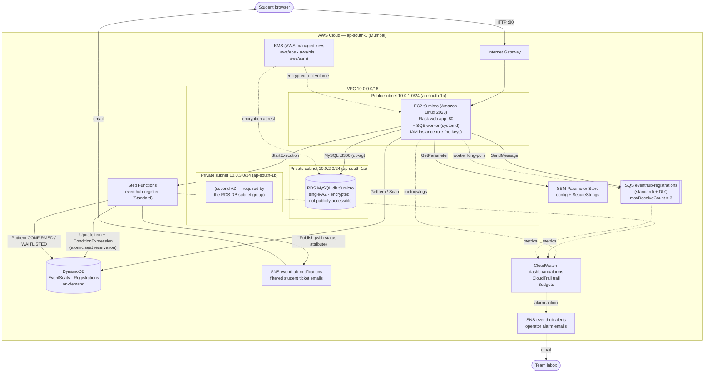

# Architecture — EventHub (BCSE355L)

## Diagram (Mermaid)



## Diagram (ASCII fallback)

```
[Student browser]
      |
      | HTTP :80
      v
[Internet Gateway] -- [EC2 t3.micro | Flask app + SQS worker | IAM instance role]
      |                                 |
      |                                 |-- MySQL :3306 ---------> [RDS MySQL db.t3.micro, private subnet, encrypted]
      |                                 |-- SendMessage ---------> [SQS + DLQ (maxReceiveCount=3)]
      |                                 |-- long-poll  <-------------|
      |                                 |-- StartExecution ------> [Step Functions eventhub-register]
      |                                 |-- GetItem/Scan --------> [DynamoDB EventSeats / Registrations]
      |                                 |-- GetParameter --------> [SSM Parameter Store]
      |                                                                  ^
      |                                                    [Step Functions role: UpdateItem+Condition, PutItem, Publish]
      |                                                                  |
      |                                                          [SNS eventhub-notifications] --filtered email--> [Student inbox]
      |                                                          [SNS eventhub-alerts] <--alarm-- [CloudWatch] --> [Team inboxes]
      |
      +---- watch: [CloudWatch dashboard/alarms] [CloudTrail trail] [Budgets]
```

## Components and why each was chosen (one paragraph each)

- **VPC 10.0.0.0/16 with 1 public + 2 private subnets.** Our own isolated network where we control every route. The public subnet (with Internet Gateway) hosts the EC2 instance because students must reach the web app from the internet. The two private subnets (no route to the internet) protect the database. Two AZs for the private subnets exist because *an RDS DB subnet group requires subnets in at least two Availability Zones even for a single-AZ instance* — this is a classic exam question.
- **Internet Gateway (no NAT Gateway).** The IGW gives the public subnet its inbound/outbound internet path. We deliberately skip NAT Gateway: it costs ~$1/day plus data processing, and nothing in our private subnets initiates outbound traffic. This is our single biggest cost saver after free-tier sizing.
- **Security groups web-sg / db-sg.** Stateful virtual firewalls: web-sg allows HTTP 80 from the internet and SSH 22 only from our IPs; db-sg allows MySQL 3306 only from web-sg. Because db-sg references web-sg as its source (not a CIDR), only our EC2 instance can ever talk to the database — defense in depth beyond "private subnet".
- **EC2 t3.micro (or the free-tier-eligible class) running both the Flask app and the SQS worker.** One instance keeps the project inside the free allowance and keeps the demo simple; both processes are managed by systemd so they restart automatically. The instance reads its permissions from an IAM instance role — no keys exist on disk (hard rule).
- **EBS root volume (8 GB, gp3, encrypted).** Instance storage for the OS and app. Encryption is enabled at launch with the AWS-managed `aws/ebs` key (no monthly KMS fee — see the report's cost note).
- **RDS MySQL (db.t3.micro, single-AZ, 20 GB, encrypted, not publicly accessible).** Relational data (users, clubs, events) with real SQL, foreign keys and transactions. RDS manages backups/patching; Multi-AZ and read replicas are deliberately left to the report because they double or triple cost. Single-AZ + private subnets + security groups is the free-tier-correct choice.
- **DynamoDB — EventSeats and Registrations (on-demand).** DynamoDB's conditional `UpdateItem` is our chosen **atomic, server-side seat reservation**. `seatsAvailable > :zero` prevents a counter from going below zero when requests race. MySQL can also make conditional updates; DynamoDB is useful here because the workflow integrates directly with it. The two-table split keeps seat counts separate from per-user history.
- **SQS standard queue + DLQ (maxReceiveCount = 3).** Decouples the web request from the workflow: the student's browser gets a fast "registration received" page while the actual work happens asynchronously. The DLQ is the safety net — any message that fails three times is preserved for debugging instead of silently disappearing.
- **Step Functions Standard workflow.** The whole seat reservation is a visible, versioned state machine (no Lambda — out of syllabus): conditional DynamoDB update, then either CONFIRMED or WAITLISTED branch, then SNS publish, with retries and catches. Execution history gives free observability, and Step Functions was chosen over SWF because it is serverless, newer, and simpler.
- **SNS ticket and alert topics.** `eventhub-notifications` carries ticket results and each student subscription filters by the `email` message attribute. `eventhub-alerts` carries CloudWatch alarm emails to the team. Students must confirm the AWS subscription email; this is a classroom demonstration of SNS filtering. SES would be a better fit for production customer email but is outside the syllabus.
- **SSM Parameter Store.** Runtime endpoints, queue/topic/workflow ARNs, and secrets live here: `db-host`, `db-user`, `db-name`, `db-password` (SecureString), `flask-secret` (SecureString), `queue-url`, `sns-topic-arn`, `alerts-topic-arn`, `state-machine-arn`. SecureStrings use the AWS-managed `aws/ssm` key. Nothing secret is in code or git.
- **IAM (group + users + two service roles).** The team group policy allows exactly the project's services, forbids out-of-syllabus services and identity management, and scopes role/PassRole permissions to `CloudProject-*`. The EC2 role and the Step Functions execution role are each least-privilege JSON files in `aws/iam/`.
- **KMS.** Encryption at rest everywhere (EBS, RDS storage, SSM SecureStrings) using AWS-managed keys so there is no $1/month customer-managed key charge. The trade-off (CMK gives key policies/rotation control) is documented in the report.
- **CloudWatch, CloudTrail, Budgets.** Module 5 observability and governance: a dashboard for queue/workflow metrics and DynamoDB conditional failures, three alarms (CPU > 70%, DLQ not empty, failed executions), a management-events trail for audit, and the budget alert recorded in Phase 0. A budget notification is not a spending cap.
- **Data split rationale.** MySQL = stable, relational, low-write data with foreign keys (users/clubs/events). DynamoDB = high-contention counters and per-user status records that need conditional writes and serverless scaling. Each store does what it is best at — a good viva talking point.
